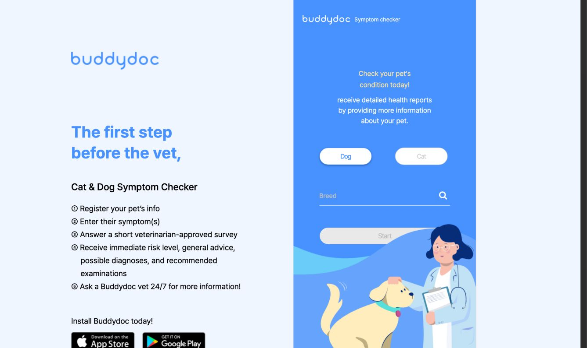
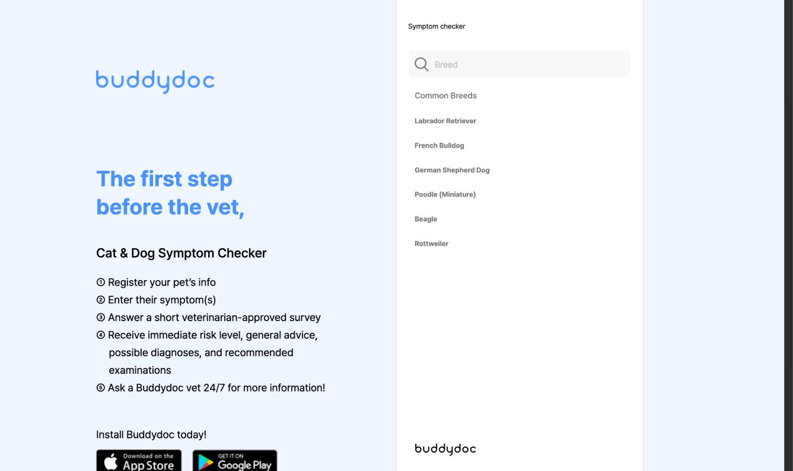
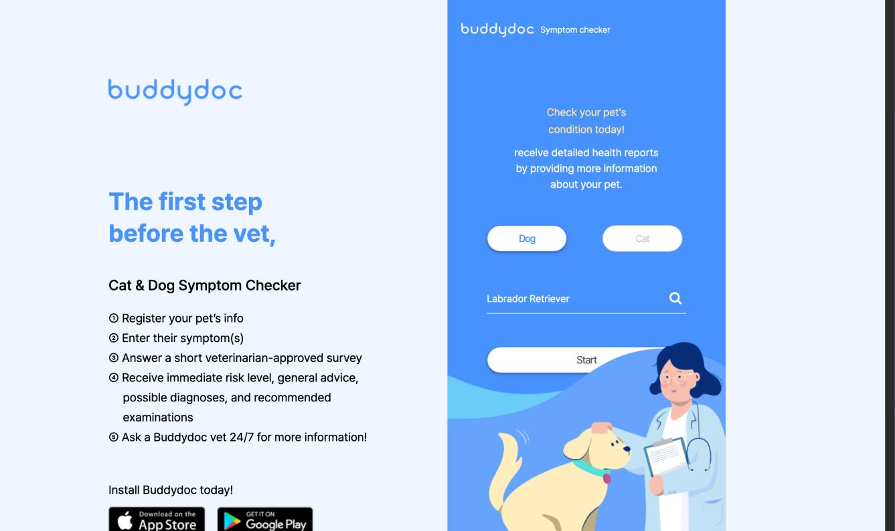
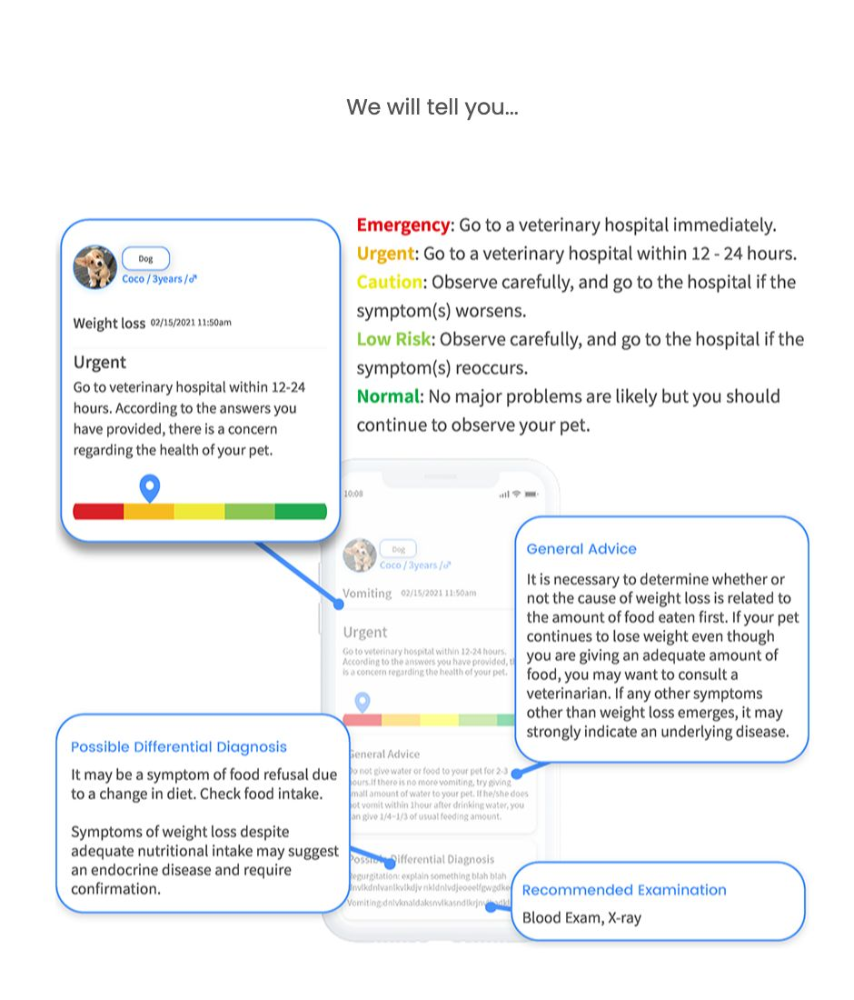

# PETAdvice: BUDDYDOC comparison and Vercel release direction

Reviewed on 2026-10-10. This is a bounded review of BUDDYDOC's public web entry flow and research into its published feature descriptions, compared with the current PETAdvice code. It is not a validation of BUDDYDOC's clinical accuracy or a full audit of its mobile app. PETAdvice's servers remain stopped; no remote services were created or deployed and no application behavior or veterinary questions were changed.

## Product direction

Help pet owners understand what they have noticed, recognise how urgently to act, and prepare for a conversation with their vet. Education and a clear next step are the main outcomes. An educational result should not imply that an examination has ruled out illness.

The user has chosen Vercel for the initial deployment. Keep the existing React/Vite frontend and FastAPI backend. The user's wife contributed veterinary input to the questions; preserve those questions and distinguish that contribution from publication of named, dated review metadata for every condition.

## Captured public flow

All accepted screenshots were captured during this review, saved and inspected from disk. Only a hypothetical dog breed was selected. No real pet history, account, contact information or payment details were entered.

### 1. Entry — clear sequence, some friction

The landing screen explains the stages and asks for species and breed before starting. This gives visitors a preview of the process. The inactive Start state does not visibly explain the missing requirement. Several pale labels against blue appear difficult to read; contrast needs measurement rather than a screenshot-based compliance claim.

### 2. Breed selection — usable common choices

Clicking the breed field opens a search surface with common breeds. Selecting Labrador Retriever returns to the entry screen and enables the visible Start control. The nested link/button pattern in the DOM and an unnamed search button warrant keyboard and screen-reader testing. Exact focus behavior and contrast ratios were not fully tested.

### 3. Start — blocked in this review

Activating both the visible Start button and its containing Start link did not advance the demo or expose an error message. No captured warning/error explained the failure. This is a session observation, not a claim that the product is unavailable for all users. The survey and generated results could not be tested.

### 4. Published result explanation — useful structure, indirect evidence

The [public symptom-checker explanation](https://www.buddydoc.io/pet_parent/symptom_checker) illustrates a report with an urgency/action label, general advice, possible conditions and examinations. This is a marketing illustration, not a result generated in this session. Its colour scale also includes text labels; the educational details are embedded in an image, which limits accessible reading and responsive enlargement. Retain explicit text actions in PETAdvice rather than relying on a colour gauge or adding a reassurance category without reviewed rules.

BUDDYDOC's [homepage](https://www.buddydoc.io/) also advertises virtual veterinary care, scheduling, records, a food reference and a diary. Those features were researched from public descriptions; their operation and availability were not verified. They suggest later opportunities, not requirements for PETAdvice's first release.

## PETAdvice's current strengths and gaps

Source checks: `web/src/App.tsx`, `web/src/api.ts`, `app/api/triage.py`, `app/api/conditions.py`, `app/api/preventive_care.py`, `app/services/triage_engine.py`, `app/models/schema.py`, and the validated content loader.

| Area | Current implementation | Recommended improvement |
| --- | --- | --- |
| Quick access | Guests can check symptoms without creating an account. | Keep this advantage. Offer learning and preventive information to guests too. |
| Results | Four urgency levels, action guidance and optional possible causes/examinations. | Explain which recorded answers or existing rules led to the urgency; separate the next action from supporting education. |
| Content coverage | 14 condition entries, 4 preventive items and 6 question trees; only one condition has possible causes and examinations. | Prioritise reviewed educational details for the existing entries. Do not fabricate causes, tests or numerical diagnostic probabilities to fill empty sections. |
| Learning | Searchable Learn and Care views require login and a pet profile in the UI, although their information endpoints are public. | Add public dog/cat browsing with search by everyday symptom words as well as condition/category. |
| Questionnaire | One question at a time, heading focus, disabled controls while saving, server-side answer validation and adaptive branches. | Add an answer recap and, later, a correction flow that discards dependent answers and recalculates the result. Avoid a fixed total for adaptive paths. Preserve the question wording. |
| Guest context | Guest requests supply species; saved pets can supply birth date, sex, neuter status and breed size. | Consider optional guest context using fields the current rules already support, with an explicit unknown choice. This changes clinical rule inputs and needs focused review/tests before release. Breed alone should not be a mandatory first step. |
| Take-away report | Guest and account exports are JSON. | Add a readable print/download summary with pet context, time, questions/answers, urgency, guidance and sources. Keep public sharing opt-in; a downloadable report can remain private. |
| History | Checks are stored, but there is no normal history/reopen screen. | Add a pet timeline for signed-in users. Preserve the advice and content version shown at the time; reopening should not silently regenerate historical advice with new rules. |
| Review information | The model supports reviewer/date/source fields; none of the 14 condition entries currently has both reviewer and review date. | Publish accurate attribution and dates only for entries actually reviewed and with the reviewer's permission. Veterinary input into the questions is already confirmed by the user. |

## Recommended scope

**First release:** Vercel adaptation, public Learn/Care access, more readable result sections, and a printable check summary. Result explanations should cite the exact existing rule/answer that contributed, and explicitly say when there is no supported explanation. Extend the result schema as needed without changing the existing question wording or escalation rules.

**Next release:** account history, correction of previous answers, and optional guest context. History must enforce existing ownership checks. Answer correction needs server-side branch replay; changing only the browser state would leave inconsistent persisted checks.

**Later:** a reviewed food-safety reference, observation diary and optional care reminders. Teleconsultation, bookings, rewards and broad symptom expansion add operational/content work; defer them while the educational core is being tested. New clinical content needs its own review.

## Vercel deployment plan

Proposed services: Vercel for the frontend/API, Neon for PostgreSQL, Upstash Redis for existing shared limits, Resend for transactional email, and QStash for triggered jobs and retries. Use compatible regional placement where available and measure latency before launch. This is a proposed configuration, not a verified cloud deployment.

[Vercel supports FastAPI](https://vercel.com/docs/frameworks/backend/fastapi) as a function, including lifespan startup. The current 30-second worker loop is unsuitable as an always-running service there. [Hobby cron jobs](https://vercel.com/docs/cron-jobs/usage-and-pricing) can run each job only once daily. [QStash](https://upstash.com/docs/qstash/features/schedules) supplies independent scheduled/triggered HTTP delivery.

1. **Package and route:** choose an explicit FastAPI entrypoint, build Vite static assets, and route browser `/api` requests to the API on the same origin. Preserve SPA fallback, security headers and cookie behavior. Never cache private API responses.
2. **Connect managed storage:** use private provider secrets, PostgreSQL TLS and a restricted application login. Use a pooled URL with bounded connections for normal requests and a direct connection for controlled migrations. Apply reviewed Alembic migrations once before traffic; do not mutate the schema in function startup.
3. **Replace polling:** retain the encrypted PostgreSQL email outbox as the durable record. Trigger delivery when an email is queued, use authenticated/signed QStash callbacks with bounded retries, and schedule reconciliation of missed triggers. Send opaque job identifiers instead of recovery tokens or email contents through the scheduler. Never depend on an untracked task continuing after a response.
4. **Deliver email:** integrate Resend through its HTTPS API or a verified supported SMTP route. Preserve expiring/superseded-link handling and document at-least-once delivery. Real recipients require a verified sending domain. This provider path has not been configured or tested yet.
5. **Schedule retention:** run bounded cleanup jobs at an agreed interval, retain immediate access expiry, and adapt readiness to scheduled-job freshness. Do not keep the two-minute worker-heartbeat requirement or query PostgreSQL every 30 seconds: that would defeat scale-to-zero and consume free database compute.
6. **Verify the deployment:** use an isolated preview database and synthetic accounts to test cookies, trusted origins/hosts/proxy handling, email verification, recovery, revocation, guest expiry/export/deletion, delayed/retried jobs, migration readiness and a backup restore. Set alerts and an off-host backup schedule before public release. Keep preview and production data/secrets separate.

The [Vercel Hobby plan](https://vercel.com/docs/plans/hobby) is restricted to personal, non-commercial use. A public educational project may fit if it remains personal and non-commercial; its audience alone does not determine eligibility. Reassess the plan if it becomes part of a veterinary business, receives commercial sponsorship or introduces paid features.

Provider accounts, domain, sender identity, operator/privacy contact and retention decisions are still pending. A free hosting address can be used for a preview, but a verified sending domain is a separate requirement. No secrets belong in this report or Git.

## Evidence limits

- The public demo stopped before the questionnaire; no claim of a completed BUDDYDOC result flow is made.
- Published mobile screenshots and service descriptions are indirect evidence and are labelled accordingly.
- The PETAdvice comparison used current code and validated content counts. The local application was not restarted for this review, and earlier screenshots were not reused as current evidence.
- Contrast, screen-reader behavior, mobile reflow and full keyboard navigation remain to be measured/tested. No WCAG compliance claim is made.
- No clinical rules, diagnoses, treatment instructions, review metadata or deployment credentials were invented or changed.
