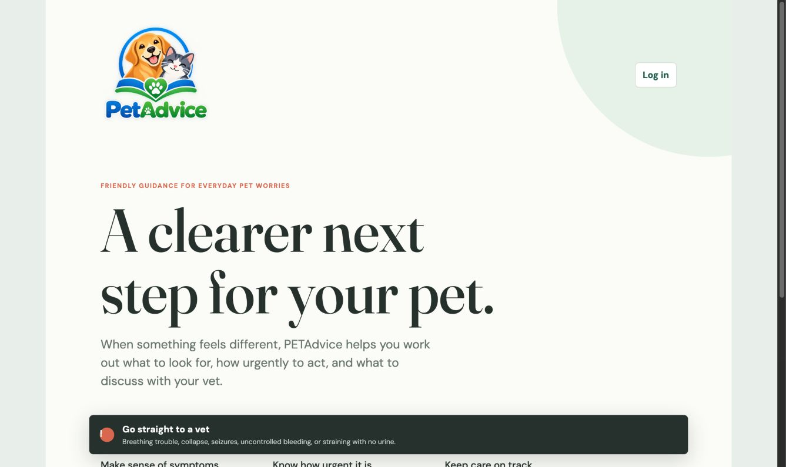
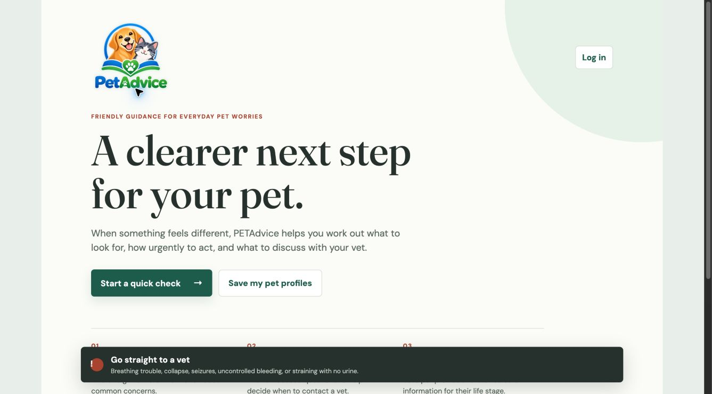
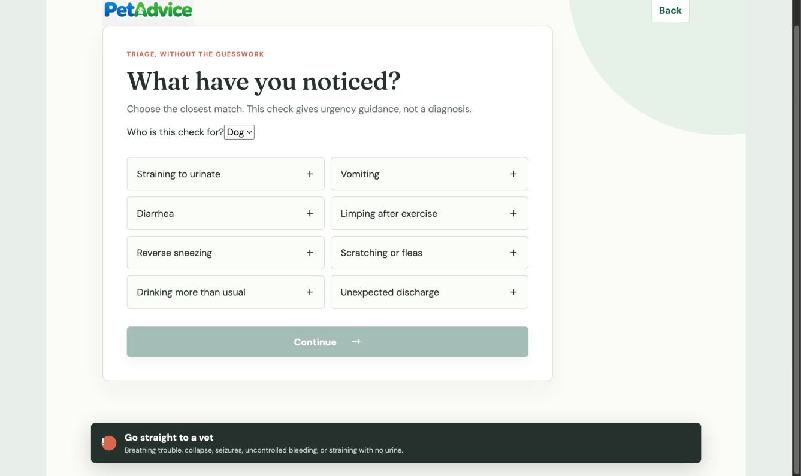
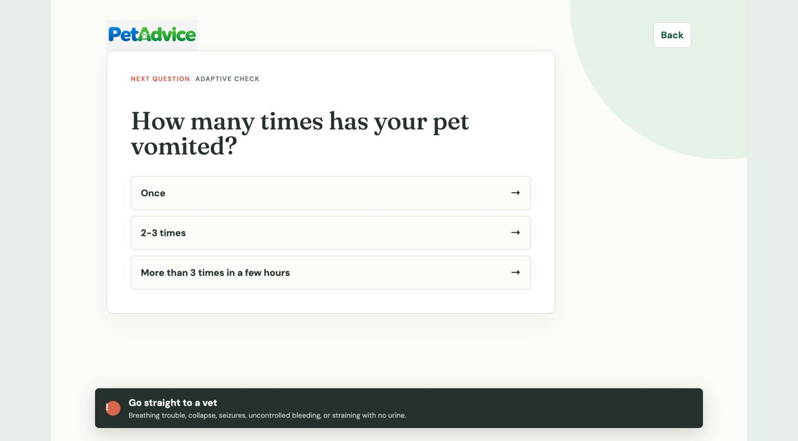
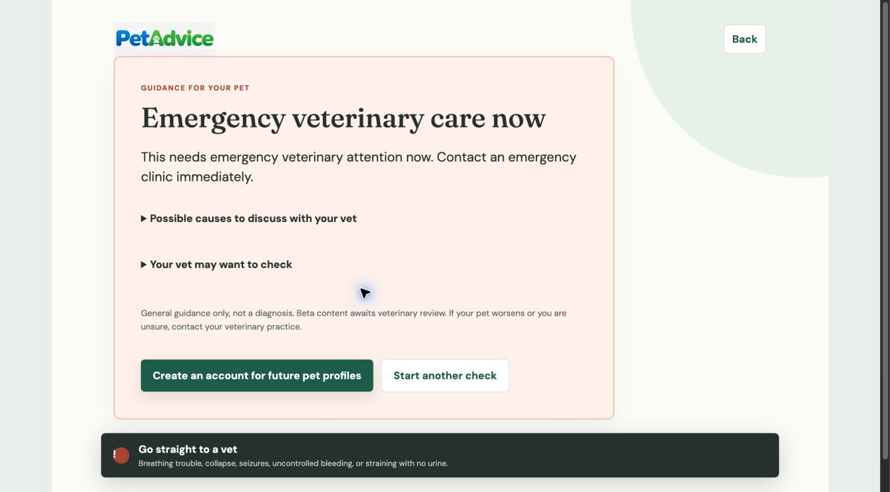
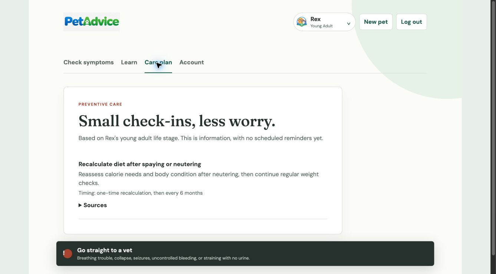
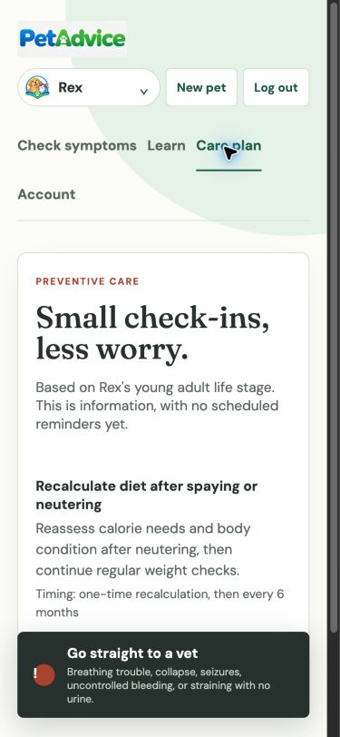
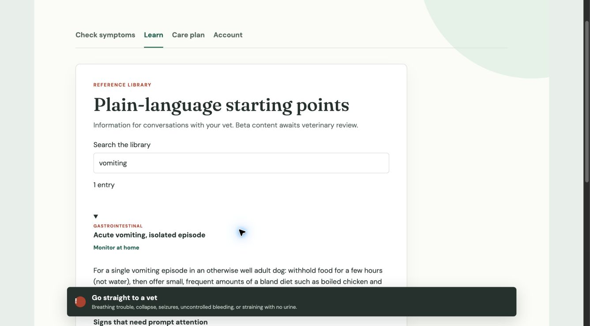
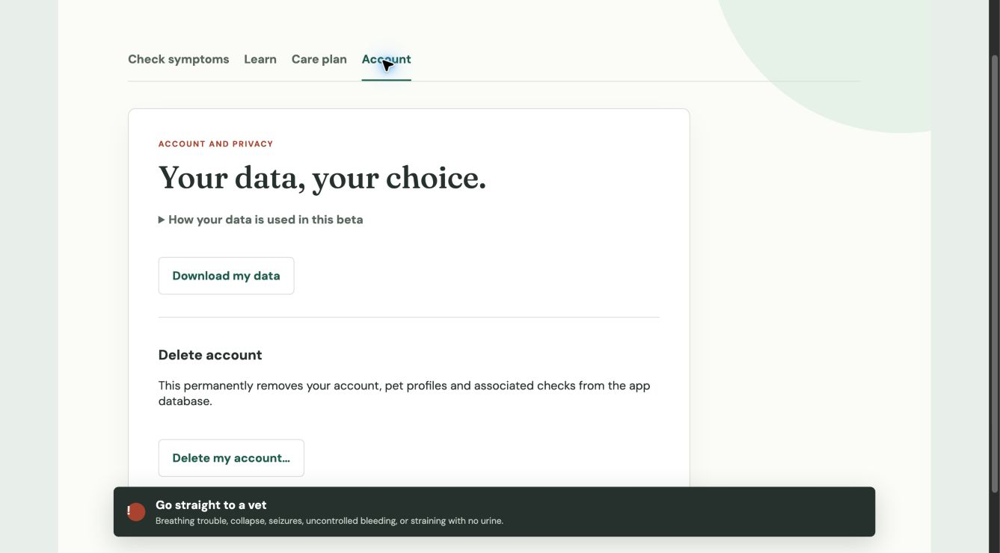

# PETAdvice code and application review

Reviewed on 9 October 2026. This is a completed first modernization pass on the local beta, with remaining release work identified below. It is not a clinical sign-off, a compliance certification, or a production deployment.

## Outcome

The code review found concrete faults in existing functionality, rather than a need to replace the stack. The application already uses React 19 and Vite 8. Compatible frontend packages and the Python stack have been updated and locked; major TypeScript and PWA changes are left for a separate migration.

The updated app has usable condition details, correct care-plan content, request feedback/recovery, safer pet switching, accessible focus/labels, and account data controls. Authentication now uses HttpOnly cookies and Argon2id. Triage rejects unsupported inputs and incomplete or rewritten sessions.

## Functionality inventory

| Area | Implemented now | Remaining product gap |
| --- | --- | --- |
| Guest quick check | Species selection, supported symptoms, adaptive questions, urgency results, restart | Capture age/sex/neuter context; guest retention/deletion; broader reviewed symptom coverage |
| Accounts | Signup, login, logout, data export and deletion | Recovery, email verification, session revocation, anti-abuse, production privacy policy |
| Pet profiles | Creation, multiple pets, switching, computed life stage | Editing/deleting an individual pet, richer relevant context |
| Learn | Species-filtered search, expandable guidance, red flags, sources, review status | Broader reviewed content and a richer content publication workflow |
| Care plan | Correct titles/descriptions/recurrence, age-aware filtering, unknown-age and empty states | Scheduling, reminders, completion tracking, broader life-stage coverage |
| PWA | Manifest, branded icon, shell, no runtime API caching, no automatic assessment reload | Real-device installation/offline/update testing and asset optimization |

No history screen or scheduled reminders have been implemented; the interface no longer implies a guest result is saved by signing up.

## Code findings and repairs

| Finding | Evidence | Repair |
| --- | --- | --- |
| Public fallback JWT secret and seven-day browser-readable tokens | `app/services/auth.py`, `web/src/api.ts` | Random process-local development secret; mandatory production secret/HTTPS origins; one-hour tokens with required claims; HttpOnly session cookies; CSRF origin checks |
| Passwords without a safe input bound; inconsistent email identity | Request models and bcrypt calls | Validated/normalized email; 15–128-character signup passwords; existing passwords still work; Argon2id for new hashes and bcrypt upgrades on login |
| Duplicate signup race could produce a server error | Signup check followed by unguarded insert | Unique-constraint errors roll back and return a controlled response |
| Unsupported symptom could create a session with home-care reassurance | Empty candidate defaults in triage engine | Reject unsupported symptoms before persisting guest data; no applicable content returns referral guidance |
| Result available before required answers; completed checks could be changed | Question-state checks and result handler | Exact current-question validation; atomic updates reject competing stale answers; completed sessions are closed; incomplete results return HTTP 409 |
| Minimum default urgency could override a more urgent matching entry | `compute_result` default aggregation | Highest applicable default wins; previously stored urgency cannot decrease |
| Other-species or incompatible entries could return through a fallback | `candidates or matched` | Removed fallback; matching stays within applicable scope |
| Invalid question graphs could load | Content loader validated individual schemas only | Validate IDs, options, answers, entry points, branch destinations, symptom boundaries and cycles |
| Switching pets retained the old triage component state | Shared `<Triage>` instance | Pet-specific component keys discard the previous check and focus new question headings |
| New profiles omitted life stage; care plan used condition fields | Create response and frontend types | Return life stage immediately; introduce a dedicated preventive-care type and display title/description/recurrence |
| Failed requests were silent or displayed raw API output | Fetch helper and uncaught triage calls | Friendly structured errors, timeout, busy states, duplicate-submission guard, loading/empty states and explicit retry |
| A failed result fetch could cause an answer to be sent again | Combined answer/result flow | Separate completed-question state; retry only the result fetch |
| Account export/deletion APIs were inaccessible from the app | Frontend navigation | Add account screen, JSON download and explicit deletion confirmation |
| Root ignored neither database files nor generated Python files | Repository configuration | Add root ignore rules; the pre-existing tracked database remains unchanged |

## Captured application evidence

The in-app browser was unavailable, so Chrome was used. Screenshots below were captured during this review, saved locally, reopened and visually inspected. Browser account testing used synthetic data in `/private/tmp/petadvice-review.db`; the existing project database was not changed.

1. **Landing — improved.** The original large heading placed the main action below the initial visible area. The updated hierarchy brings quick-check access into view and explains the beta's review status. The persistent emergency reference is a strength; the page still scrolls on smaller screens.

   
   

2. **Symptom selection — improved.** The original screen provided a clear starting task but a visually unstyled species selector and selection indicated mainly by color. Selection now has pressed state, the selector follows form styling, dog-only options are hidden for cats, and unavailable symptoms have a referral instruction.

   

3. **Adaptive questions — improved.** The original question screen was legible and had clear response options. The revised flow adds pet context, disabled controls during requests, visible error/restart paths and focus on the next question. DOM/browser checks confirmed the focus behavior; automated tests cover result-fetch retry.

   

4. **Urgency result — functioning.** A synthetic vomiting check with an emergency answer immediately displayed emergency guidance. Action language replaces internal enum names; possible causes/examinations are collapsed behind disclosures, keeping the urgent action prominent. The result also states the clinical-review limitation.

   

5. **Care plan — repaired.** Browser testing with a young-adult dog confirmed the actual preventive-care title, description and timing now display. The screen makes clear that timing information is not a scheduled reminder. At 390 × 844, navigation wraps and controls remain readable; the document did not exceed the viewport width. The fixed emergency banner requires scrolling to see lower content.

   
   

6. **Learn — repaired.** Searching for vomiting reduced the list to one entry. Expanding it exposed guidance, red flags and review status. Urgency has a text label, and disclosure controls have explicit accessible names. The screenshot captures the visible upper part of the expanded entry; the longer content requires scrolling.

   

7. **Account/privacy — improved.** The account screen exposes data download and account deletion with a second confirmation step. API tests validate isolation, password-hash exclusion and deletion. Browser review stopped at the controls; no account was deleted through the browser.

   

## Validation

- **44 backend tests passed**, with no warnings after installing the locked stack.
- **4 frontend regression tests passed.** Coverage includes switching pets, care response fields, failed-result retry without another answer submission, and library search/details.
- Production TypeScript/Vite build passed with strict TypeScript checks.
- Frontend lint passed without warnings; `git diff --check` passed.
- `npm audit` reported **zero known vulnerabilities**, after fixing `serialize-javascript` and `source-map-js` advisories.
- `pip-audit` checked the complete pinned Python requirements and reported **no known vulnerabilities**.
- Browser verification covered guest emergency branching, cookie login, pet loading, care content, library search/details, account controls and mobile care-plan reflow.
- GitHub Actions configuration has been added but has not run remotely. Local checks are the evidence for this pass.

Vulnerability results are a point-in-time advisory check, not proof that all application behavior is secure.

## Standards used

The security changes follow current [FastAPI password/JWT guidance](https://fastapi.tiangolo.com/tutorial/security/oauth2-jwt/), [OWASP password-storage guidance](https://cheatsheetseries.owasp.org/cheatsheets/Password_Storage_Cheat_Sheet.html), [authentication guidance](https://cheatsheetseries.owasp.org/cheatsheets/Authentication_Cheat_Sheet.html), and [session-management guidance](https://cheatsheetseries.owasp.org/cheatsheets/Session_Management_Cheat_Sheet.html). The accessibility target is [WCAG 2.2](https://www.w3.org/TR/WCAG22/): visible focus, status/error announcements, readable urgency labels, usable control sizes and reduced motion. No full conformance claim is made.

Workflow actions are pinned to verified current releases of [checkout](https://github.com/actions/checkout/releases/tag/v7.0.1), [setup-node](https://github.com/actions/setup-node/releases/tag/v7.1.0) and [setup-python](https://github.com/actions/setup-python/releases/tag/v7.0.0).

## Prioritized next work

### Before public users

1. **Veterinary content and decision-tree review.** Test representative emergencies and uncertain answers; validate age/sex/neuter scope, thresholds and species-specific pathways. Guest checks currently omit important context. Replace heuristic red-flag text matching with explicit, reviewed answer outcomes. Sparse content is not a complete symptom service.
2. **Persistence and migration discipline.** Move to durable PostgreSQL storage with a tested migration plan, backups and restore testing. Replace startup SQLite table alterations with versioned migrations. Preserve existing data during the transition.
3. **Abuse and session controls.** Add gateway/shared-store rate limits for login, signup and guest checks; password recovery, verification, session revocation and reauthentication for sensitive actions. Clearing the cookie does not revoke an already copied bearer token, which lasts up to one hour.
4. **Privacy and retention.** Publish an operator-specific policy with hosting, retention and contact details; document backup deletion; clean up expired guest data; add a way to manage/delete guest checks. Data export and deletion alone do not establish legal compliance.
5. **Production topology and monitoring.** Deploy behind same-origin `/api` routing or a same-site HTTPS API, configure exact trusted origins, stable secret management, logs without personal data, uptime/error monitoring and tested rollback. Unrelated Vercel/Render domains will not work with the new SameSite cookie model.
6. **Repository hygiene.** The existing `petadvice.db` is already tracked. Ignore rules do not remove it from current tracking or Git history. Preserve a local backup, then resolve tracking/history before publishing code containing real accounts. No database/history cleanup was performed in this pass.

### Product follow-up

Add pet editing, a visible check history, richer reviewed preventive content, scheduling/reminders, and broader symptom coverage. Optimize the original 1–1.5 MB brand images, self-host font assets if appropriate, and test installation, offline startup and service-worker upgrades on actual devices. Decompose the app into feature files as the workflows grow.

## Evidence limits

Screenshots and DOM observations support the flow and layout findings. Screen-reader use, exhaustive keyboard journeys, measured contrast on every state, 200%/400% zoom, all mobile platforms, real service-worker upgrade/offline scenarios, production hosting and clinical accuracy were not fully tested. The code and automated checks provide additional evidence but do not turn those untested areas into verified claims.
